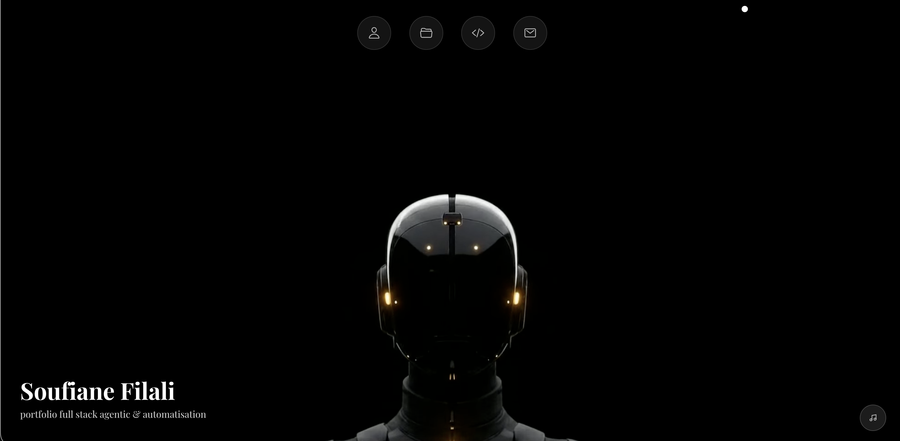

# 👋 Salut, je suis Souf-F !

  

  
  
  
  
  
  

  <b>Développeur Full Stack @ Holberton School Toulouse | Construction de systèmes agentiques et intelligents</b>

---

## À propos

Développeur Full Stack à Holberton School Toulouse, je construis des systèmes agentiques où les LLM planifient, agissent et bouclent — toujours sous supervision humaine, jamais sans.

---

## Statistiques GitHub

  
  

  

  

---

## Stack technique

**Langages**

  
  
  
  
  
  

**IA et Agentique**

  
  
  
  

**Frameworks et librairies**

  
  
  
  

**Bases de données**

  
  
  

**Outils et environnement**

  
  
  
  

---

## Projets agentiques

| Projet | Description | Stack | Lien |
|--------|-------------|-------|------|
| **Pennyworth** | Majordome numérique : transforme une intention en langage naturel en plan d'actions, rien ne s'exécute sans validation humaine | Claude API, Python, FastAPI | [pennyworth.adamzou.fr](https://pennyworth.adamzou.fr) |
| **La Taupe** | Agent RAG durci contre l'injection de prompt indirecte : les documents hostiles sont mis en quarantaine au niveau des données, jamais au niveau du prompt | Python, FastAPI, Claude API | [github.com/Souf-F](https://github.com/Souf-F/hackathon-agentique) |
| **AI Study Guide** | Pipeline multi-agents qui génère des guides d'étude structurés : explicateur, créateur d'exercices et relecteur en séquence | Google ADK, LiteLLM, Ollama | [repo](https://github.com/Souf-F/ai-agents-intro) |
| **Oxydian** | Auditeur de configuration Google Workspace en lecture seule, avec frontend React/TS | React, TypeScript, Vite, Go | Privé |
| **Portfolio** | Site personnel : animations canvas, réseaux de particules, globe 3D | Vanilla JS, HTML/CSS | [aeonlabs.fr](https://aeonlabs.fr/) |
| **Cyber Cheatsheet** | Plateforme d'apprentissage cybersécurité : 54 fiches, système XP, 43 badges | Vanilla JS | [cyber-cheatsheet.aeonlabs.fr](https://cyber-cheatsheet.aeonlabs.fr/) |

---

## Ma vision des agents

- **Humain dans la boucle :** un agent qu'on ne peut pas arrêter est un risque, pas un outil
- **Donnée vs autorité :** les entrées externes sont des données, un agent qui les traite comme des commandes est déjà compromis
- **Empreinte minimale :** un agent ne demande que les permissions nécessaires à l'étape en cours
- **Traces lisibles :** chaque action journalisée, chaque décision explicable

---

## Contact

 [linkedin.com/in/soufiane-filali-dev](https://www.linkedin.com/in/soufiane-filali-dev/)

 [aeonlabs.fr](https://aeonlabs.fr/)

---

> **"Un agent qui agit sans comprendre n'est que de l'automatisation. Fais-le comprendre d'abord."**
